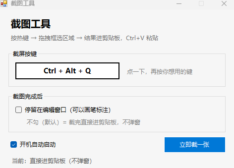
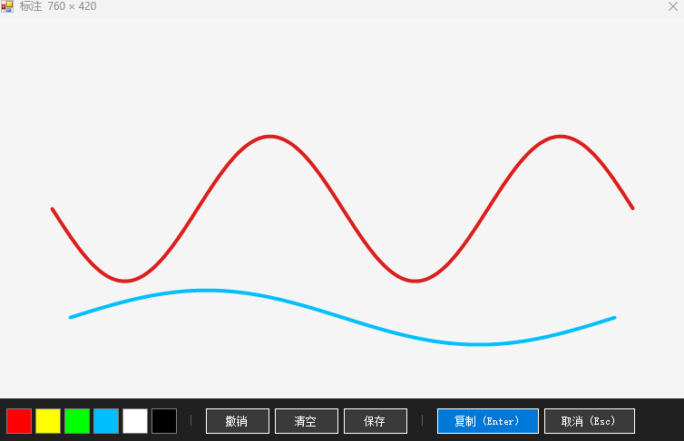

# SnapTool · Windows 极简截图工具

一个单文件 Windows 截图工具：**拖一下框选 → 图片已经在剪贴板 → Ctrl+V 粘贴**。
程序约 29KB，零依赖（只用系统自带 .NET Framework 4.x），双击即用，不用安装。



## 为什么又做一个截图工具

截图软件的常规套路是功能越堆越多，但日常真正用到的只有两件事：框一块区域、把它粘出去。
这个工具只做这两件事，并把它们做顺手：

- **默认框选**，不是截整屏
- **截完直接进剪贴板**，不弹窗、不确认、不打断你正在做的事
- 需要画两笔的时候，才切到"停留编辑"模式，用完再关

## 功能一览

| 功能 | 说明 |
|---|---|
| 框选截图 | 拖拽选区，框上实时显示「宽 × 高」；双击直接截全屏；Esc / 右键取消 |
| 热键自定义 | 点一下按钮，直接按你想用的组合键，按下即生效，没有预设下拉 |
| 两种完成方式 | 默认：直接进剪贴板；勾选后：停留在一个可标注窗口里 |
| 画笔标注 | 6 种颜色、4px 圆头笔，Chaikin 平滑 + 抗锯齿，撤销 / 清空 / 保存 PNG / Enter 复制 |
| 开机自启动 | 写入当前用户启动项，勾选即生效，不需要管理员权限 |
| 托盘常驻 | 点 × 只缩到托盘，热键始终可用 |
| 多显示器 | 按虚拟屏幕整体截图，可以跨屏框选 |



## 使用

1. 双击 `SnapTool.exe`（不需要任何运行库安装）
2. 按默认热键 **Ctrl + Alt + Q**
3. 拖动鼠标框出一块区域，松开即完成
4. 到任意软件里 **Ctrl + V**

### 截图时的键

| 操作 | 效果 |
|---|---|
| 左键拖拽 | 框选区域 |
| 双击 | 截整个屏幕 |
| Esc / 右键 | 取消这次截图 |

### 改热键

点主界面「截屏按键」那个大按钮 → 按组合键 → 立即生效。
无修饰键时只允许 F1–F12 / PrintScreen / Pause / ScrollLock；组合键被别的程序占用时会自动退回原值并提示。

### 标注（勾选"停留在编辑窗口"后）

| 操作 | 效果 |
|---|---|
| 左键拖动 | 画笔 |
| Ctrl + Z / 撤销 | 撤销上一笔 |
| Ctrl + S / 保存 | 存到 `图片\Screenshots\shot_日期_时间.png` |
| Enter / 复制 | 带标注的图进剪贴板 |
| Esc / 取消 | 这次作废 |

## 编译

不需要 Visual Studio，也不需要 .NET SDK，用 Windows 自带的 csc 就行：

```bat
build.bat
```

或手动执行：

```bat
C:\Windows\Microsoft.NET\Framework64\v4.0.30319\csc.exe /nologo /target:winexe /optimize ^
  /out:SnapTool.exe SnapTool.cs ^
  /r:System.dll /r:System.Drawing.dll /r:System.Windows.Forms.dll
```

> 注意：`SnapTool.cs` 必须保存为 **UTF-8 带 BOM**。csc 对无 BOM 的中文源码会解析失败。

自己验证一下编译与运行环境：

```bat
SnapTool.exe --selftest
```

会在同目录生成 `selftest.log`（含虚拟屏幕尺寸、截图尺寸、裁剪、剪贴板写入结果）。

## 配置文件

`%APPDATA%\SnapTool\config.ini`

```ini
stay=0            ; 1 = 截完停留编辑
hotkeyMods=3      ; 修饰键位掩码: Alt=1, Ctrl=2, Shift=4, Win=8
hotkeyVk=81       ; 虚拟键码 (81 = Q)
```

删掉这个文件就恢复默认（直接进剪贴板 + Ctrl+Alt+Q）。

## 实现要点

几个踩过的坑，写下来省得别人重走：

- **写剪贴板不要用 `Clipboard.SetDataObject`**：在无消息泵的环境里会报"所请求的剪贴板操作失败"。这里直接 P/Invoke `OpenClipboard` + `GlobalAlloc` + `SetClipboardData(CF_DIB)`。
- **画笔要平滑**：逐段 `DrawLine` 会出折角；`GraphicsPath.AddCurve` 在稀疏采样点上会过冲冒尖角。最终用 Chaikin 细分（不过冲）+ `DrawLines` + 抗锯齿，笔头圆角。
- **采样要补点**：鼠标事件间隔不定，移动快时点很稀疏，按 2px 间距插值补点再平滑。
- **重绘要局部**：只刷新当前笔画包围盒，别整窗刷新，否则长笔画会拖影。

## 已知限制

- 仅 Windows（WinForms + P/Invoke）
- 笔迹固定 4px 线宽，没有压感、没有变宽笔刷
- 标注只有画笔，没有文字、箭头、马赛克
- 剪贴板走 CF_DIB，个别很老的程序可能不识别 Alpha 通道

## English

SnapTool is a minimal single-file screenshot tool for Windows: drag to select a region, release,
and the image is already in your clipboard — no preview window, no confirmation.
The hotkey is remappable by simply pressing it. Zero dependencies (.NET Framework 4.x, preinstalled
on Windows 10/11). Build with the built-in `csc` — no SDK or IDE required.

## License

[MIT](LICENSE)
